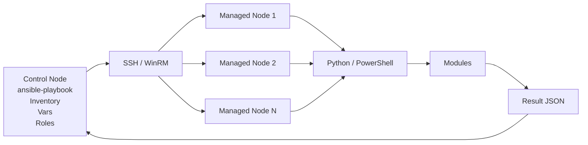
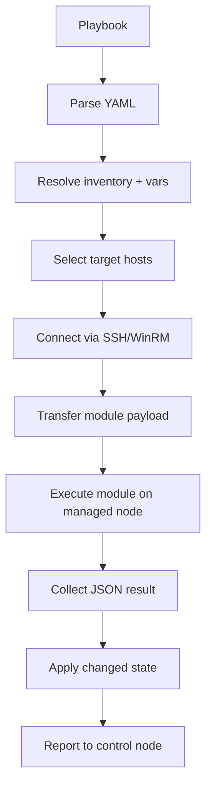

# 02. Ansible Architecture

Ansible follows a control-node model. A central machine, the control node, reads configuration, communicates with managed nodes, and collects results.

## High-level architecture


## Control node
The control node is the machine that runs Ansible commands and playbooks. It contains inventory, variables, roles, collections, and the Ansible installation itself.

### Common tasks on the control node
```bash
ansible --version
ansible-inventory --list -i inventory.ini
ansible-playbook site.yml
```
These commands are run from the control node.

## Managed nodes
Managed nodes are the servers or devices being configured. They may be Linux EC2 instances, on-prem servers, or Windows machines.

## Inventory
Inventory defines which hosts are managed and how to reach them. It may be static text or dynamic inventory from AWS, Azure, or other sources.

### Example inventory
```ini
[webservers]
app1 ansible_host=10.0.0.10 ansible_user=ubuntu
app2 ansible_host=10.0.0.11 ansible_user=ubuntu

[dbservers]
db1 ansible_host=10.0.0.20 ansible_user=ec2-user
```
Inventory groups hosts logically so playbooks can target them by pattern.

## Ansible configuration file
The main configuration file is usually `ansible.cfg`. It sets defaults such as inventory path, SSH options, and callback behavior.

### Example
```ini
[defaults]
inventory = ./inventory.ini
host_key_checking = False
```
This config changes default inventory and disables interactive host key prompts.

## Playbooks
A playbook is a YAML file that contains one or more plays. A play targets a set of hosts and applies tasks to them.

```yaml
---
- name: Configure web servers
  hosts: webservers
  become: true
  tasks:
    - name: Install nginx
      ansible.builtin.apt:
        name: nginx
        state: present
```

## Plays
A play is the unit that maps a group of hosts to a set of tasks and variables. Each play has an `hosts` value and optional `become`, `vars`, and `tasks` sections.

## Tasks
A task is an individual operation such as installing a package, copying a file, or restarting a service.

```yaml
- name: Start nginx
  ansible.builtin.service:
    name: nginx
    state: started
```

## Modules
Modules are the units of work. They are executed on the target host to perform actions. Ansible modules return JSON results.

Examples:
- `ansible.builtin.copy`
- `ansible.builtin.apt`
- `amazon.aws.ec2_instance`

## Plugins
Plugins extend Ansible functionality. Common plugin types include action plugins, filter plugins, lookup plugins, inventory plugins, callback plugins, and connection plugins.

## Roles
A role is a reusable directory structure containing tasks, handlers, templates, defaults, vars, and files. Roles make playbooks easier to organize and share.

## Collections
Collections package modules, plugins, and roles under a namespace such as `amazon.aws` or `community.general`.

### Relationship
- A role is a reusable bundle for a single service or app.
- A collection is a broader package with modules and plugins.
- A plugin adds behavior to the Ansible engine.
- A module is the actual action executed on a host.

## SSH connection
For Linux, Ansible uses SSH to connect to managed nodes. It authenticates with SSH keys, passwords, or other supported methods.

```bash
ssh -i ~/.ssh/id_rsa ubuntu@10.0.0.10
```
Use this to verify the SSH path outside Ansible.

## Python interpreter on managed nodes
Ansible modules run on the target node via Python. On most Linux distributions, Ansible uses `/usr/bin/python3` or an equivalent interpreter.

```bash
ansible all -m setup | head
```
This gathers facts from the targets and confirms Ansible can execute Python-based modules.

## Internal execution flow
1. Ansible reads inventory and variables.
2. It loads the playbook and tasks.
3. It resolves host patterns and variables.
4. It connects to each host.
5. It copies the module or executes a remote Python snippet.
6. The module runs on the target.
7. JSON results return to the control node.
8. Handlers and task results are processed.

### Execution flow diagram


## Modules are transferred and executed
Ansible copies a module payload or uses the Python interpreter to run it on the target. The module returns structured JSON, which Ansible interprets as success, failure, changed, or skipped.

## Result handling
Each task result includes details such as:
- `changed`
- `failed`
- `skipped`
- `msg`
- `stdout`

### Example debug output
```yaml
- name: Show system facts
  ansible.builtin.debug:
    var: ansible_facts
```
This prints gathered facts to the control node console.

## Summary
The Ansible architecture is built around a control node that reads declarative configuration, connects to managed nodes, executes modules, and returns results. Inventory, variables, roles, modules, and plugins make the system modular and scalable.
